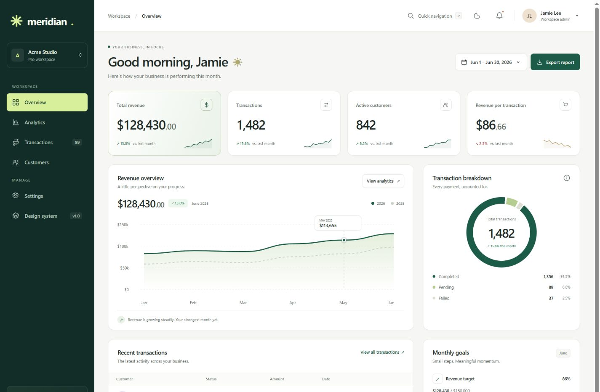
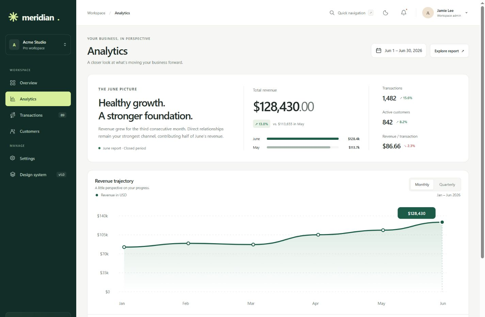
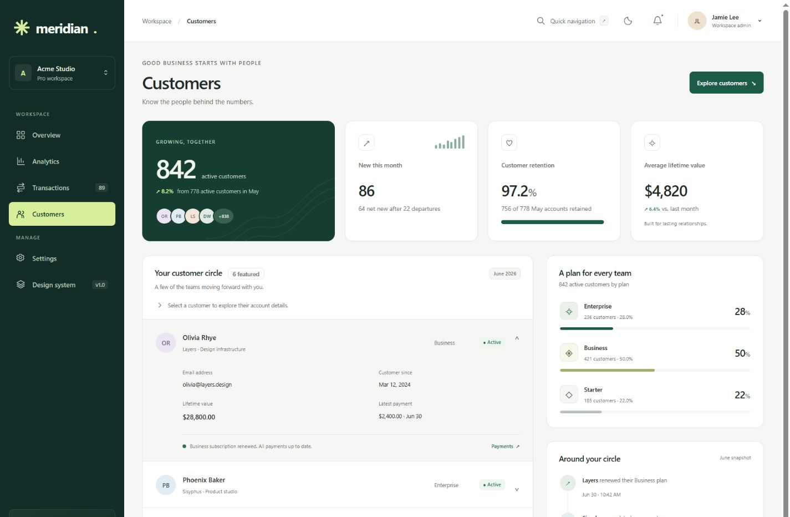
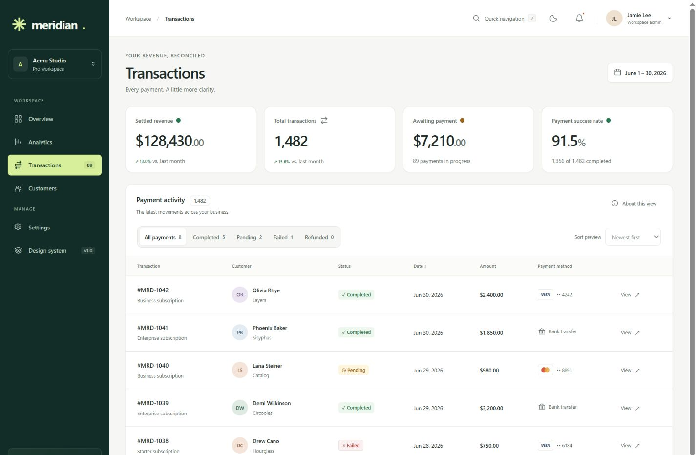
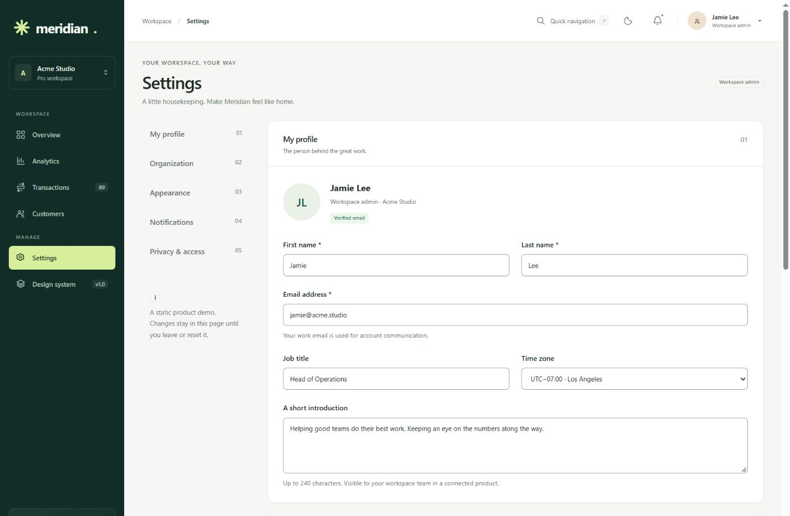
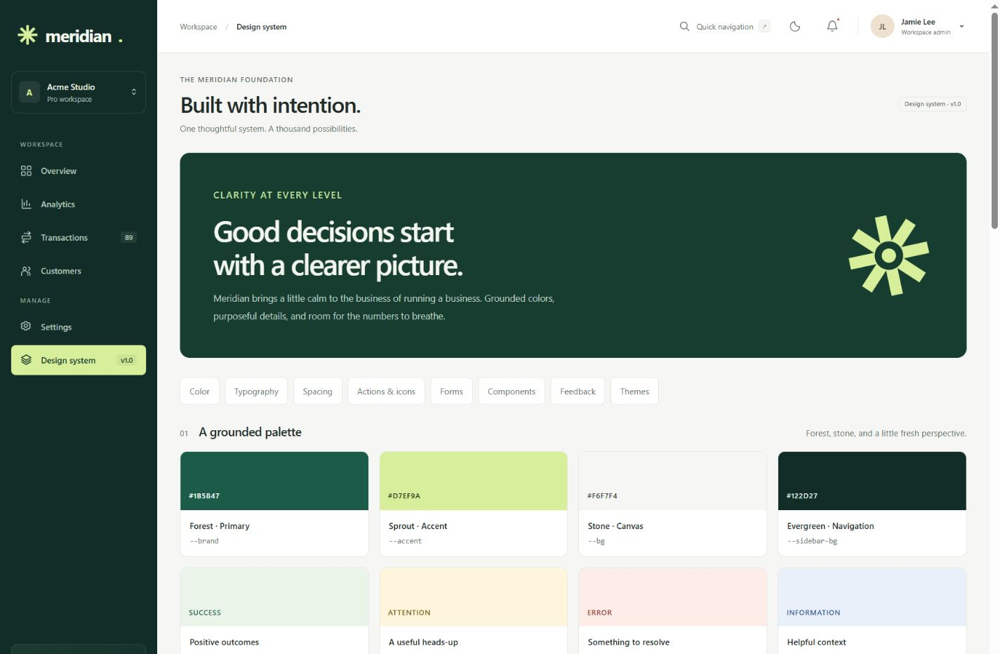
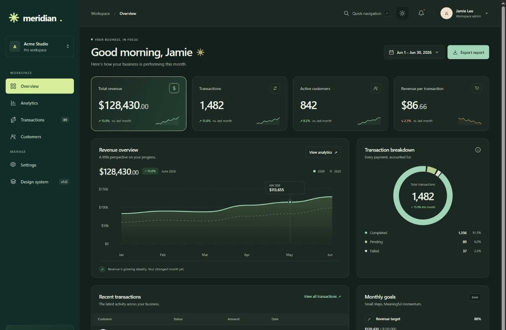
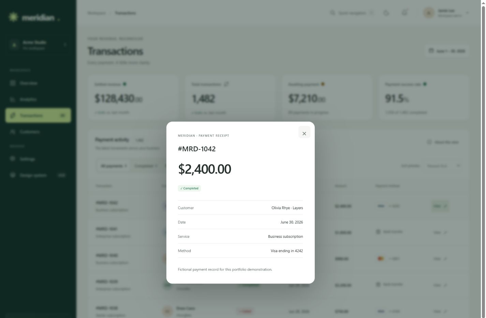
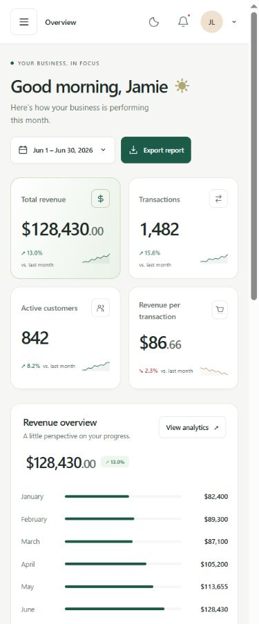

# Meridian

**Clarity at every level.**

A responsive revenue operations dashboard for the fictional Acme Studio workspace. Meridian brings revenue trends, payment health, and customer relationships into a cohesive six-page interface, built entirely with semantic HTML, modern CSS, and inline SVG. This portfolio project demonstrates how a reusable design system, purposeful information hierarchy, and native browser interactions can create a polished SaaS experience without a JavaScript runtime or build step.

## Application Preview



<details>
<summary><strong>Explore the other five pages</strong></summary>

<table>
  <tr>
    <td width="50%">
      <a href="docs/screenshots/analytics.jpg"></a><br>
      <a href="analytics.html"><strong>Analytics</strong></a> · Trends and business comparisons
    </td>
    <td width="50%">
      <a href="docs/screenshots/customers.jpg"></a><br>
      <a href="customers.html"><strong>Customers</strong></a> · Accounts and relationships
    </td>
  </tr>
  <tr>
    <td width="50%">
      <a href="docs/screenshots/transactions.jpg"></a><br>
      <a href="transactions.html"><strong>Transactions</strong></a> · Payment records and status views
    </td>
    <td width="50%">
      <a href="docs/screenshots/settings.jpg"></a><br>
      <a href="settings.html"><strong>Settings</strong></a> · Profile and workspace preferences
    </td>
  </tr>
</table>

[**Design System**](design-system.html) · Brand foundations and reusable component specimens



</details>

<details>
<summary><strong>See dark appearance, a native receipt, and the mobile layout</strong></summary>

<table>
  <tr>
    <td width="50%"><a href="docs/screenshots/overview-dark.jpg"></a><br><strong>Dark appearance</strong> · The same semantic component system</td>
    <td width="50%"><a href="docs/screenshots/receipt-detail.jpg"></a><br><strong>Receipt detail</strong> · Native opening and dismissal</td>
  </tr>
</table>

<p align="center"><a href="docs/screenshots/overview-mobile.jpg"></a><br><strong>Mobile overview</strong> · Reflowed cards and labeled revenue meters</p>

</details>

Actual browser captures, with consistent desktop framing and a separate phone viewport. [Capture notes and dimensions](docs/screenshots/README.md).

## Key Features

- **Six connected views:** overview, analytics, transactions, customers, settings, and a dedicated design system.
- **Readable business data:** SVG trends, sparklines, status distributions, funnels, goals, and a downloadable June report.
- **Genuine native interactions:** CSS status views and chart intervals, customer disclosures, receipt popovers, and form validation/reset.
- **A shared foundation:** semantic theme tokens, reusable components, responsive grids, and page-specific compositions.

## Tech Stack

**HTML5 · CSS3 · Inline SVG.** Grid, Flexbox, cascade layers, container queries, custom properties, and `:has()` power the interface. No packages, external fonts, frameworks, or build tools are required.

## UI/UX Design System

### Color


| Role / CSS token | Light | Dark | Purpose |
| --- | --- | --- | --- |
| Primary · `--brand` | `#1B5B47` | `#A2D4B8` | Actions, chart lines, emphasis |
| Secondary surface · `--brand-soft` | `#EAF2E8` | `#233E31` | Quiet emphasis and contextual panels |
| Accent · `--accent` | `#D7EF9A` | `#D7EF9A` | Selected navigation and brand detail |
| Canvas · `--bg` | `#F6F7F4` | `#14201B` | Workspace background |
| Surface · `--surface` | `#FFFFFF` | `#1B2922` | Cards and controls |
| Text · `--text` | `#202B27` | `#EDF2E9` | Headings and primary content |
| Muted · `--text-muted` | `#66716A` | `#B0BDB1` | Supporting labels |
| Navigation · `--sidebar-bg` | `#122D27` | `#122D27` | Persistent application anchor |

Success, warning, error, and information states have separate text/surface pairs. The complete palette lives in [tokens.css](assets/css/tokens.css).

### Typography, spacing & components

| Element | Implemented system |
| --- | --- |
| Fonts | Segoe UI → platform system fonts → Arial; SFMono-Regular / Consolas for code |
| Type hierarchy | Page titles 26–32px; KPI values 24–31px; card titles 14px; body 13px; compact metadata generally 9–12px |
| Weight & rhythm | Tokens 400 / 500 / 600 / 700; body line-height 1.6; heading line-height 1.2 |
| Spacing | 4px foundation: 4, 8, 12, 16, 20, 24, 32, 40, 48px |
| Layout | 1,560px maximum content width; 226px sidebar; fluid 16–36px page gutters; larger-screen overrides |
| Surfaces | Radius tokens 6 / 10 / 14 / 18px; 1px borders; subtle elevation such as `0 8px 28px #122d2710` |
| Controls & icons | 40px standard buttons, 33px compact variant; 18px rounded line icons with 1.7px strokes |

**Responsive:** navigation becomes a drawer at 900px. Container queries adapt the overview to available workspace width; revenue charts become labeled meters at 520px in Overview and 650px in Analytics, and dense tables scroll within their own regions.

**Accessibility:** skip links, visible keyboard focus, semantic landmarks, labeled forms, table captions, chart descriptions, textual statuses, and reduced-motion support. Core text/status token pairs were checked against 4.5:1 contrast and form borders against 3:1; full audit limits are documented in the engineering notes.

## Design Decisions

- **A grounded identity:** evergreen navigation anchors the workspace; lime highlights selection while neutral surfaces keep attention on the data.
- **Numbers first:** distinct metric sizing and tabular numerals make comparisons easy. System fonts keep the interface fast and fully local.
- **Consistency with purpose:** shared tokens and controls connect the six pages, while each layout suits its task. Reflowed charts and native controls preserve useful information on smaller screens.

## Getting Started

Open [index.html](index.html) directly, or serve the project root with Python if already installed:

```sh
python -m http.server 8080 --bind 127.0.0.1
```

Visit [localhost:8080](http://localhost:8080). There is no installation or build step.

**Scope:** fixed, fictional June 2026 data. Theme and form preferences are page-local; authentication, live queries, payment processing, server-side sorting, and pagination are not implemented. Use a current browser for `:has()`, container queries, and native popovers.

[Engineering notes, data definitions & verification](docs/ENGINEERING.md) · [Asset inventory & replacement guide](ASSETS.md)
